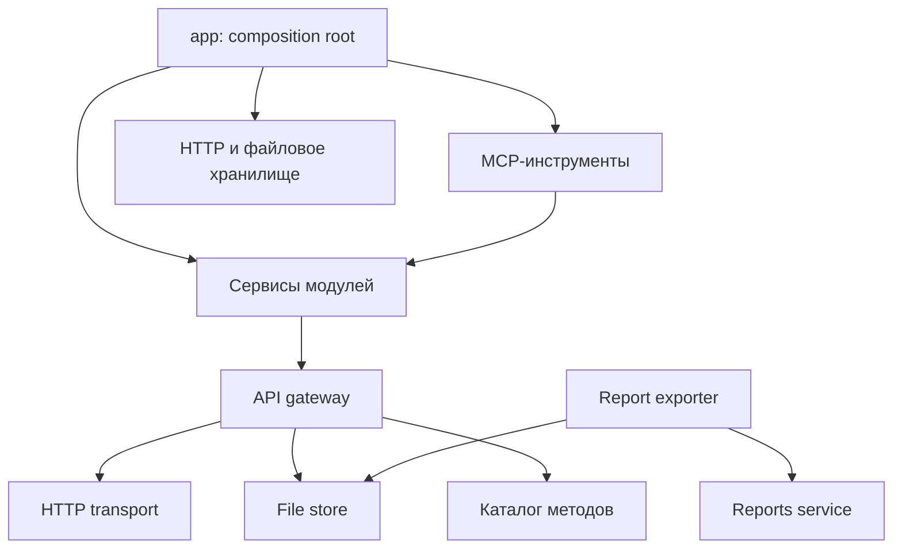

# Архитектура MCP Яндекс Метрики

Принято: модульная слоистая архитектура с явным внедрением зависимостей.
Решение сохраняет 15 инструментов MCP, существующие параметры `.env`, каталог
96 операций для аналитики сайта без рекламы и электронной коммерции,
а также поведение отчётности. Внешний интерфейс приложения — MCP;
внутренние JS-классы предыдущей реализации заменены сервисами.

## Рассмотренные варианты

| Вариант | Когда подходит | Решение |
| --- | --- | --- |
| Модульная слоистая архитектура | Один внешний API, несколько сценариев управления и отчётов | Выбрана: явные границы при небольшом числе абстракций |
| Hexagonal / Ports & Adapters | Несколько транспортов, провайдеров аналитики и способов хранения | Возможное развитие; сейчас отдельные порты для каждого сценария избыточны |
| Минимальный перевод на TypeScript | Нужны только статические типы при неизменной структуре | Не решает дублирование HTTP-клиентов и смешение экспорта с запросами |

## Структура

```text
src/
  index.ts                 запуск stdio, ошибки старта
  index.js                 совместимый запуск dist/index.js
  app/
    create-application.ts  composition root: создание и связывание зависимостей
  config/                  окружение, .env, пути относительно корня проекта
  core/                    ошибки, проверка ответов, последовательная очередь записей
  infrastructure/
    http/                  единственный HTTP-транспорт к Яндексу
    files/                 файловый ввод/вывод и публикация готовых файлов
  modules/
    catalog/               проверка и поиск методов, метрик, документации
    api/                   построение запросов по каталогу и multipart
    management/            сценарии управления счётчиком и JS-целями
    reports/               формы отчётов, пагинация, CSV/JSONL, полнота данных
  mcp/
    server.ts              создание MCP-сервера
    register-tool.ts       единая обработка результатов и ошибок
    tools/                 регистрация инструментов по модулям
  api-catalog.json          снимок официального справочника
```



## Используемые паттерны

- **Composition Root и Constructor Injection.** Только `createApplication` создаёт
  транспорт, хранилище, очередь и сервисы. DI-контейнер и глобальные сервисы не нужны.
  В тестах можно подменить `fetch`, `HttpTransport` или `FileStore`.
- **Service Layer.** `ManagementService` содержит проверки и последовательности
  управления целями. `ReportsService` формирует отчёты. `ReportExporter` управляет
  пагинацией и форматом выгрузки.
- **Gateway / Adapter.** `ApiGateway` преобразует операции каталога в запросы.
  `YandexHttpClient` выполняет HTTP и хранит OAuth-токен. `LocalFileStore` работает
  с файлами. Сервисы не вызывают `fetch` или файловые API напрямую.
- **Schema-first contracts.** Типы входных данных выводятся из Zod через
  `z.input` / `z.output`. Ответы API входят как `unknown` и проверяются на границах.
  Каталог тоже валидируется перед использованием. Динамические тела универсального
  API остаются `unknown`, поскольку их контракт определяется выбранной операцией.
- **Общая очередь записей.** Универсальные изменения и сценарии «прочитать — проверить —
  изменить» используют один `SerialExecutor`. Внутренний `execute` не ставит запрос
  повторно в ту же очередь, поэтому сценарии не блокируют сами себя.
- **Публикация файла после завершения.** Данные пишутся в `.partial`, готовый файл
  публикуется переименованием. При ошибке отчёта удаляются созданные им файлы.

Repository и Unit of Work не используются: локальной базы данных и транзакций нет.
Здесь они добавили бы лишний слой над HTTP API.

## Правила зависимостей

1. `mcp` преобразует протокол и делегирует работу сервисам; бизнес-проверки находятся в модулях.
2. `modules` не импортирует `mcp` или `app` и не создаёт инфраструктуру.
3. `infrastructure` не импортирует прикладные модули и не выбирает сценарии работы.
4. `core` не зависит от конфигурации, MCP, инфраструктуры или прикладных модулей.
5. `config` не зависит от сервисов. `.env`, `imports` и `exports` разрешаются от корня
   проекта одинаково для исходников и для сборки, независимо от рабочего каталога.
6. Никакой модуль кроме HTTP-транспорта не отправляет HTTP-запросы к Яндексу.

## TypeScript и сборка

Включены `strict`, `noUncheckedIndexedAccess`, `exactOptionalPropertyTypes`,
`noImplicitOverride`, `noUnusedLocals` и `noUnusedParameters`. В исходниках нет
`any`, `@ts-ignore` и отключения проверки файлов. `skipLibCheck` применяется только
к декларациям зависимостей. См. [strict](https://www.typescriptlang.org/tsconfig/strict.html)
и [NodeNext](https://www.typescriptlang.org/tsconfig/module.html) в документации TypeScript.

`tsc` собирает ESM для Node.js в `dist/`, после чего `scripts/copy-assets.mjs`
копирует каталог API. Сборка не требует TypeScript-загрузчика при запуске.
Секреты и файлы пользователей не копируются. Для обычного запуска нужен Node.js;
Python используется только разработчиком при обновлении каталога документации.
`scripts/update-api-catalog.py` применяет профиль к методам, полям и ссылкам перед
сохранением снимка. `--from-snapshot` применяет тот же профиль без сети. Операции,
исключённые из каталога, недоступны шлюзу; параметры универсальных отчётов и контракты
оставшихся методов передаются без дополнительного ограничения по профилю.

JavaScript-тесты проверяют собранный код и границы валидации, включая входные данные,
которые статически корректный TS-клиент обычно не создаст. `npm run check` запускает
проверку типов, сборку и тесты. Имена MCP-инструментов и их контракты остаются прежними.
